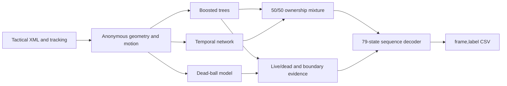

# Persian Lions: technical report

The system labels football possession from the competition's tactical tracking. It combines anonymous team geometry and motion, boosted classifiers, a temporal neural network and duration-based sequence decoding. A football dead-ball model, trained on the same external matches, decides most of the live/dead (D) label. The selected models and parameters are fixed. The repository contains the weights and inference code needed to regenerate the CSV without retraining or downloading training data, and the scripts that trained the dead-ball model.

The design follows three properties of the task: player slots are anonymous, ball observations are incomplete, and the ranking rewards complete possession spells. The table explains the engineering purpose of each component. Its measured selection advantage is described below; these motivations alone do not prove a performance gain.

| Technique | Why it is present | Implementation to read |
|---|---|---|
| Tactical tracking as the input | Positions and team membership are already supplied, allowing the method to focus on possession. This path needs no new detector, video labels or camera alignment. | [reader.py](persian_lion/reader.py), [epts.py](persian_lion/epts.py) |
| Canonical team sets and gated geometric assignment | Slot numbers can change identity. Sort points within each team and estimate motion from nearby sets instead of following slot indices as people. | [features.py](persian_lion/features.py) |
| Histogram gradient boosting | Learn nonlinear relationships between physical geometry, live/dead status, ownership and transitions using the external tracking features. | [tree.py](persian_lion/tree.py), [boundary.py](persian_lion/boundary.py) |
| A small temporal convolutional network (TCN) | Use observations before and after an uncertain moment, with a defined context window and practical local CPU inference. | [model.py](persian_lion/model.py), [temporal.py](persian_lion/temporal.py) |
| Shared team encoders and antisymmetric owner logits | Exchanging H/A inputs should exchange ownership evidence, rather than allowing a fixed preference for a team identifier. | [model.py](persian_lion/model.py), [tree.py](persian_lion/tree.py) |
| Missing-value flags, observation age, frozen normalization and external corruption training | Represent absent evidence explicitly and expose fitting to imperfect tracking. These measures have not solved real occlusion, as the results below show. | [features.py](persian_lion/features.py), [model.py](persian_lion/model.py); training recipe in [TESTING_REFERENCE.md](TESTING_REFERENCE.md) |
| A 50/50 tree–neural ownership mixture | Combine boosted physical-feature and learned temporal evidence using the mixture selected by external validation. The tree features also contain temporal context. | [predict.py](persian_lion/predict.py) |
| Football dead-ball model (histogram gradient boosting, 205 features per frame) | Stoppages leave a visible shape in the tracking: players standing still, a wall at a free kick, a taker at the touchline, a lone player at a goal. A dedicated classifier of live versus dead, using player geometry, the ball when it is seen, and about 10 s of context, was much better at D than the original trees (measured below). | [football.py](persian_lion/football.py), [external/train_deadball.py](external/train_deadball.py) |
| Boundary and duration sequence decoding | Discourage unsupported ownership flicker while allowing turnovers and dead-ball resets. This addresses the spell-based objective. | [structured.py](persian_lion/structured.py), [decode.py](persian_lion/decode.py) |

The prediction flow is:



The supplied inputs used at inference are `tactical/BAR-ATH_tactical_atd.xml` and `tactical/BAR-ATH_tactical_atd.txt`. Metadata resolves team membership and coordinate channels. One-based tracking frame n maps to zero-based CSV frame n−1 at 25 Hz. Normalized coordinates become centered metres using the published 105.3 × 68.0 pitch dimensions. Track slots are treated as anonymous team sets; their index is not a player identity. Gated geometric assignments estimate short-term motion. Missing coordinates remain missing. Video, broadcast tracking, homography and Smart Tagging are not used by the selected release; independently validated fusion of those assets was not established.

Features describe ball/player proximity, relative motion, team shape, observation age, missingness and pitch boundaries. Anonymous motion uses one-to-one assignments at ±5 frames, gated at 13 m/s; both preceding and following matches must be valid. This estimates short-term velocity, not persistent identity. Context features include finite-value averages and nearby observations within the same half.

A symmetric 138,565-parameter temporal network takes 59 global and 88 features per team. Six residual convolution blocks use kernel size 3, dilations 1/2/4/8/16/32, LayerNorm, GELU and training dropout. They supply 12.6 seconds of context on either side at 5 Hz, in addition to feature context. Five interleaved streams recover every 25 Hz frame without crossing halves. Median/IQR normalization was fitted only on external training data and is stored in the checkpoint; normalized values are clipped and paired with finite-value flags. Shared team encoders and antisymmetric ownership logits preserve team-exchange symmetry. The selected inference path uses the neural ownership output; its auxiliary live/dead and boundary heads remain in the checkpoint but are not used for those decisions.

Neural and boosted-tree ownership probabilities are mixed equally. The live probability is a log-odds blend of the football dead-ball model (weight 0.9) and the physical trees (weight 0.1); the trees also supply turnover/restart boundary probabilities. Owner logits are softened by a factor of 0.35 when the ball is missing. An offline dynamic program uses 39 capped duration states for each live team and one dead state, for 79 states in total. Selected transition costs are 1 between teams and 60 into/out of D, with boundary evidence weight 1.5 and short-spell penalty 6. The full settings are in [models/parameters.json](models/parameters.json). Future context is used because this is a post-match task.

For each half, the decoder maximizes `sum(log emission probability) - switch costs - short-spell penalties`. If `l` is live probability and `h` is the softened conditional home probability, the H/A/D emissions are `[l*h, l*(1-h), 1-l]`, with numerical clipping in the implementation. Completed interior live spells receive the soft penalty `6 * max(0, 1 - duration/39)`; long spells have no maximum length. This sequence objective is a surrogate: the official spellF1 is used to select settings, not directly optimized by this dynamic program.

Possession continuity is represented by transition and duration costs, rather than assigning the nearest player independently in each frame. Exactly neutral ownership evidence retains the last team when the sequence objective is tied. D resets ownership; the next live spell can belong to either team. Missing ball alone does not imply D. These mechanisms support the challenge's loose-ball and restart conventions, but they do not guarantee that every deflection, controlled touch or stoppage is recognized correctly.

The principal labelled training source is IDSSE: Bassek, Rein, Weber and Memmert (2025), [A public dataset of synchronized spatiotemporal and event data in elite soccer](https://doi.org/10.1038/s41597-025-04505-y), CC BY 4.0. This release uses Sportec/DFL tracking ownership and live/dead annotations, not labels created by this team. Four full matches, J03WMX, J03WN1, J03WOH and J03WOY, contain 567,278 native 25 Hz frames and fitted the model and normalization using clean and corrupted views. The dead-ball model was fitted on the same four matches. Two different matches, J03WPY and J03WQQ, selected parameters. For the dead-ball model all three of J03WPY, J03WQQ and J03WR9 were held out (see below). J03WR9 supplied repeated diagnostics. No competition-game annotations were used for fitting or selection. To expose the dead-ball model to imperfect tracking, its training uses synthetic degradation of the external matches ([external/augment.py](external/augment.py)): players vanish, stray tracks appear, noise is added and the ball is hidden in random stretches, at two fixed generic severity levels ("moderate" and "severe", written as round numbers, with about 33% and 57% of the ball hidden). They are not fitted to any particular tracker, and nothing from the provided game is used. [TESTING_REFERENCE.md](TESTING_REFERENCE.md) records the pinned sources, training amounts, transformations and exposure history.

Four SkillCorner matches supplied automatic-provider validation checks; eight further matches supplied repeated diagnostics. Metrica public sample games supplied partial event-based checks. ELASTIC annotations were inspected in a proposed supervision audit but did not fit the selected weights. No Kaggle dataset, NVIDIA model, hosted inference API or additional pretrained vision model is required. The latest SkillCorner Barcelona–Real Madrid match was acquired only after model selection and used once as an additional diagnostic. The reference document distinguishes provider estimates and partial event labels from independently verified dense possession truth.

The concrete selection reason is the external comparison: 102 configurations were evaluated, 46 met the fixed safeguards, and eligible configurations were ranked first by dense spellF1, then dense macroF1, then provider spellF1. A candidate had to preserve the fixed physical-tree reference's mean spellF1 separately across dense, detected-only and extrapolated validation groups. The selected combination improved dense mean spellF1 from **0.619764 to 0.649450**. These are repeatedly used development cases, not an untouched test set. This establishes the reason for choosing this configuration among those tested, without establishing superiority over untested architectures.

Later alternatives did not justify replacement: extra interpolated-gap training reduced dense spellF1 to **0.637225**, and the corrected learned sequence calibration reduced it to **0.584081**. Sparse event-control fine-tuning was stopped before fitting. An earlier calibration formula was disqualified for a mathematical monotonicity failure before its numeric performance was reviewed. Experiment summaries and outcomes are consolidated in [TESTING_REFERENCE.md](TESTING_REFERENCE.md). No pretrained vision or tagging-fusion alternative demonstrated a validated gain in this work; their absence is an engineering limitation, not evidence that they cannot help.

The dead-ball model was evaluated on three held-out external matches (J03WPY, J03WQQ, J03WR9). Its dead-ball F1 was 0.998 to 0.999 on clean tracking, 0.968 to 0.983 at the moderate degradation and 0.949 to 0.964 at the severe one; the false-D rate on live frames was 0.1 to 0.2%, 1.5 to 2.3% and 2.5 to 2.7%. Through the full decoder, mean spellF1 over the three matches with the trees alone (football weight 0) was 0.619 (moderate) and 0.464 (severe); with the dead-ball model at weight 0.9 it was 0.636 and 0.550, and alive/dead F1 rose from 0.971 to 0.981 and from 0.872 to 0.969. The blend weight 0.9 was chosen on these held-out matches ([external/sweep_blend_weight.py](external/sweep_blend_weight.py)); weights from 0.65 to 1.0 differ by at most 0.003 at moderate degradation. The degradation used in training and in evaluation is the same family, three matches is a small sample, and all of them were seen during development, so treat these as development evidence. Most of the gain is on badly degraded tracking. The retained model achieved mean validation spellF1 0.6495 and macroF1 0.9238 across six conditions of two external matches. A subsequent J03WR9 stress test with 41% missing ball observations achieved spellF1 0.6318 and frame accuracy 93.69%; shuffling player slots changed no predictions. These are external development results, not competition scores.

The more realistic fresh Barcelona–Real Madrid test exposed a substantial weakness: agreement with automatic provider ownership was 79.63% overall, 86.03% with the ball observed and 46.42% with the ball missing. The references cover 69.40% of evaluated timestamps and favor observed-ball frames. They cannot establish full-match accuracy, stoppage accuracy or spellF1. This evidence does not establish competition readiness or a winning rank. Principal limitations are naturally correlated missing ball/player observations, boundary errors, source-label differences and unused automatic tagging/video evidence. Detailed results, unsuccessful experiments and qualification of each metric are consolidated in [TESTING_REFERENCE.md](TESTING_REFERENCE.md).

For teammates improving the model, separate the measured weaknesses from possible explanations:

| Weakness and observed evidence | What this does and does not establish |
|---|---|
| Natural missing-ball observations: **46.42% owner agreement**, compared with 86.03% when observed. | Transfer to this missing-observation subset is poor. Co-occurring player occlusion, gap length, tracking errors and source-label differences are plausible contributors; this test does not isolate their causes. |
| On 3,225 missing-ball samples with known owner references, 922 predictions chose the opposite team and 806 chose D. | Ownership and live/dead evidence both need investigation. The provider has no independent live/dead truth here, so the 806 D disagreements are not 806 proven false stoppages. |
| Artificial 41% missingness lowered spellF1 from **0.751622 to 0.631811**, while frame accuracy remained 93.69%. | Whole possession recovery remains sensitive to missing observations. Frame accuracy alone can conceal boundary or segmentation problems. |
| With supplied extrapolated tracks, mean diagnostic spellF1 was **0.559547**, versus 0.570077 for an earlier development reference; six of eight matches regressed. | Robustness to that representation is limited. This comparison uses the earlier development model, not the fixed pure-tree selection reference above. |
| Four fitting matches, two reused dense validation matches, and only partial/automatic fresh references. | Evidence of generalization is limited. Complete output coverage, a passing validator and a fast runtime do not establish football correctness. |
| No explicit controlled-touch classifier and no use of Smart Tagging/video. | Deflections, contested balls and restarts are represented indirectly. The current mechanisms do not guarantee the competition's control semantics in every case. |

Two implementation details give concrete hypotheses to investigate. First, [Match](persian_lion/data.py) carries coordinates and missingness but no detected-versus-extrapolated confidence field, so a finite supplied estimate can look like an observation. Second, ownership softening leaves the raw live probability unchanged but can still change the joint H/A/D preference. For example, live probability 0.55 and conditional home probability 0.90 give H=0.495 and D=0.45; applying the 0.35 owner-logit factor gives H approximately 0.376 while D remains 0.45. Sequence costs and neighboring evidence may override this preference. This calculation explains a possible mechanism in [emission_probabilities](persian_lion/structured.py), not the established cause of the external D disagreements. The 39-frame duration cap is also a soft penalty scale, not a hard minimum possession length.

The following are **proposals for external experiments, not implemented or proven fixes**:

| Improvement area | Code entry points | Experiment and evidence needed |
|---|---|---|
| Real missing ball/player observations | [features.py](persian_lion/features.py), [model.py](persian_lion/model.py), [predict.py](persian_lion/predict.py), [structured.py](persian_lion/structured.py) | Evaluate naturally occluded external matches and corruption that also removes players. Compare gap-length/visibility-aware confidence or ownership fusion against the fixed 0.35 softening and 50/50 mixture. Keep separate observed/missing diagnostics. Simple interpolated-gap training already failed its acceptance checks. |
| Live/dead and restart decisions | [tree.py](persian_lion/tree.py), [boundary.py](persian_lion/boundary.py), [predict.py](persian_lion/predict.py) | Obtain independent external stoppage/restart annotations, then assess live/dead calibration and boundary timing. Automatic owner-only references cannot validate this fix. |
| Turnover timing and excessive smoothing | [boundary.py](persian_lion/boundary.py), [structured.py](persian_lion/structured.py), [decode.py](persian_lion/decode.py) | Compare boundary features, transition costs or structured objectives using whole-sequence spellF1 and macroF1. Do not promote a change solely because its training loss or frame accuracy improves; the rejected calibration experiment demonstrates this risk. |
| Extrapolation and noisy detections | [features.py](persian_lion/features.py), [reader.py](persian_lion/reader.py) | Test quality-aware geometry or motion gates separately on detected and extrapolated external tracks, retaining anonymous-slot behavior. Do not manually repair target observations. |
| Additional automatic evidence | New adapters beside [reader.py](persian_lion/reader.py), fusion in [predict.py](persian_lion/predict.py) | Validate any Smart Tagging, homography or video integration on suitable external matches first. Phase intervals are not possession boundaries; unknown team tags and broadcast/tactical time alignment need explicit handling. No compatible validated fusion is supplied here. |

Use the current commit as the baseline and work on a separate development branch. Reacquire licensed external data from the pinned sources in [TESTING_REFERENCE.md](TESTING_REFERENCE.md); downloaded data is not included. The scripts in [external/](external/) retrain the dead-ball model only; refitting the trees and the network requires rebuilding that external pipeline. Preserve match-level training/validation/test separation, reserve genuinely unseen matches, and treat every diagnostic already reported here as exposed. Compare one change at a time on the same inputs using the official spellF1, macroF1, per-class errors and missingness subsets. Report reference coverage, and measure D precision/recall only where valid live/dead truth exists. Keep slot-permutation, team-exchange, half-reset, frame-alignment and reproduction checks. Freeze any accepted weights, parameters, source and manifest only after those checks; never use the competition match to select the change or regenerate manifest hashes merely to conceal an unvalidated edit.

To reproduce, install Python 3.12 and `requirements.txt` (which includes the pinned `requirements-lock.txt`), then run the verification and prediction commands in [README.md](README.md). The added entry point sits alongside the team's original starter utilities:

```sh
.venv/bin/python starter/predict_possession.py \
  --data-dir /absolute/local/path/to/licensed-match \
  --output 'Persian Lions.csv'
```

An explicit `--data-dir` overrides the existing `MTAH_DATA_DIR` environment variable; if the variable is set, the flag can be omitted. The module command `python -m persian_lion predict` remains supported. The output has exactly 199,319 ordered `frame,label` rows. H means Barcelona live possession, A Athletic Club live possession, and D stopped play. X is emitted outside the published graded halves. Validate the exact output with the included official `evaluation/validate_submission.py`, as described in the README. Actual inputs remain outside the repository, and generated outputs are ignored by Git. Model hashes and a local output manifest support reproducibility; the reference environment is Python 3.12.12 on an Apple M1 CPU with two threads. The submission CSV is not stored in the repository; it is generated locally with the commands above.

The [official task](https://github.com/metrica-sports/more-than-a-hack-2027/blob/main/CHALLENGE.md) and [submission contract](https://github.com/metrica-sports/more-than-a-hack-2027/blob/main/SUBMISSION.md) define the output and deliverables. The organizer clarification provided to the team requires external-only training and tuning and takes precedence over the older unsupervised allowance in the public rules. The public five-minute labels were not used to select or tune any parameter or model, and no prediction was repaired by hand.

## Use of AI tools

AI assistants were used under human supervision.

- **Supervisor:** Claude Code supervised the engineering work: it reviewed and simplified code, ran tests, trained and evaluated the dead-ball model on the external (non-competition) matches.
- **Executor (local):** the generation of the submission file from the provided match data, and its validation, were carried out on the team's own machine by a local LLM agent: OpenCode driving Qwen (`qwen3.8:27b`, 128k-context variant) served by Ollama. No hosted model was used for that step.
- **Models in the release:** the released models are gradient-boosted trees, a small convolutional network and a decoder, all trained on external tracking data; no LLM is part of the pipeline and none is needed to run it.
